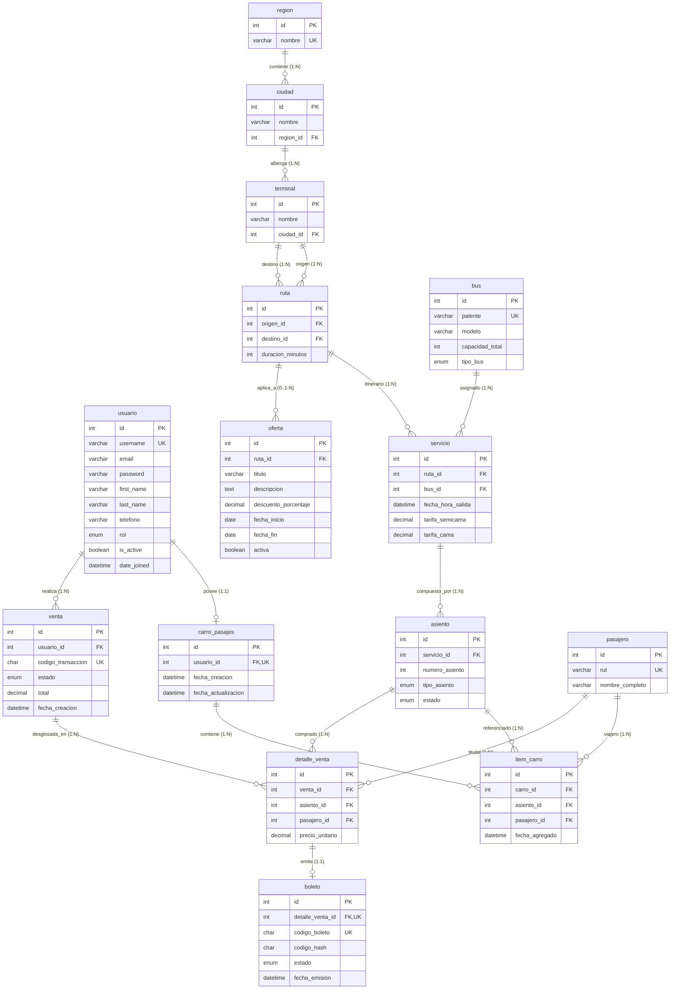

# Modelo de Datos en Tercera Forma Normal (3FN) - BusDrex

**Proyecto 4:** Reservas de Pasajes de Buses Interurbanos (Inspirado en Turbus.cl)  
**Evaluación 2:** Programación Back End | **Año Académico:** 2026  
**Estudiante:** Benjamin Gómez | **Sección:** AP-N4-C1  
**Base de Datos:** MySQL 8.0 (Motor personalizado `custom_mysql`)  
**Fuente de Verdad:** [busdrex.dbml](file:///docs/busdrex.dbml)  

---

## 1. Diagrama Entidad-Relación en Tercera Forma Normal (Mermaid)

El siguiente diagrama `erDiagram` refleja de manera exacta las 15 tablas, sus relaciones y cardinalidades especificadas en `busdrex.dbml`:

---

## 2. Análisis y Justificación de Formas Normales por Entidad

Para que una base de datos relacional alcance la **Tercera Forma Normal (3FN)**, debe satisfacer:
1. **Primera Forma Normal (1FN):** Todos los atributos son atómicos (sin grupos repetitivos ni colecciones) y la tabla tiene una clave primaria definida.
2. **Segunda Forma Normal (2FN):** Cumple 1FN y todos los atributos no clave tienen dependencia funcional completa respecto a la clave primaria (sin dependencias parciales en claves compuestas).
3. **Tercera Forma Normal (3FN):** Cumple 2FN y ningún atributo no clave depende funcionalmente de otro atributo no clave (ausencia de dependencias transitivas: $X \rightarrow Y \rightarrow Z$).

A continuación se detalla la justificación formal para las 15 tablas:

| Entidad (Tabla) | Clave Primaria (PK) | Dependencias Funcionales | Cumplimiento 1FN, 2FN y 3FN |
|---|---|---|---|
| **`usuario`** | `id` | `id` $\rightarrow$ `username`, `email`, `password`, `first_name`, `last_name`, `telefono`, `rol`, `is_active`, `date_joined` | **1FN:** Columnas escalares y atómicas. **2FN:** PK simple de un solo campo, no hay dependencias parciales. **3FN:** Todos los atributos dependen únicamente de la PK. Se extrajo `pasajero` para evitar mezclar datos de clientes con personas que viajan. |
| **`pasajero`** | `id` | `id` $\leftrightarrow$ `rut` `rut` $\rightarrow$ `nombre_completo` | **1FN:** Atributos atómicos. **2FN:** PK simple. **3FN:** El nombre del pasajero depende funcionalmente de su RUT chileno. Al aislarlo aquí, se elimina la redundancia en carro, detalle y boletos. |
| **`region`** | `id` | `id` $\leftrightarrow$ `nombre` | **1FN:** Atómica. **2FN:** PK simple. **3FN:** Entidad pura de catálogo regional. |
| **`ciudad`** | `id` | `id` $\rightarrow$ `nombre`, `region_id` `(nombre, region_id)` es única | **1FN:** Atómica. **2FN:** PK simple. **3FN:** Depende directamente de `region_id` sin dependencias transitivas intermedias. |
| **`terminal`** | `id` | `id` $\rightarrow$ `nombre`, `ciudad_id` `(nombre, ciudad_id)` es única | **1FN:** Atómica. **2FN:** PK simple. **3FN:** Se eliminó la dependencia transitiva anterior (`terminal` $\rightarrow$ `ciudad` $\rightarrow$ `region`) dejando solo la FK a `ciudad_id`. |
| **`ruta`** | `id` | `id` $\rightarrow$ `origen_id`, `destino_id`, `duracion_minutos` `(origen_id, destino_id)` es única | **1FN:** Atómica, duración almacenada en minutos enteros. **2FN:** PK simple. **3FN:** Los terminales origen/destino y la duración dependen estrictamente del trayecto. Restricción Check: `origen != destino`. |
| **`bus`** | `id` | `id` $\leftrightarrow$ `patente` `patente` $\rightarrow$ `modelo`, `capacidad_total`, `tipo_bus` | **1FN:** Atómica. **2FN:** PK simple. **3FN:** Atributos propios del vehículo de la flota sin atributos transitivos. |
| **`servicio`** | `id` | `id` $\rightarrow$ `ruta_id`, `bus_id`, `fecha_hora_salida`, `tarifa_semicama`, `tarifa_cama` | **1FN:** Atómica. **2FN:** PK simple. **3FN:** Asocia ruta, bus, horario y tarifas vigentes para ese itinerario. |
| **`asiento`** | `id` | `id` $\rightarrow$ `servicio_id`, `numero_asiento`, `tipo_asiento`, `estado` `(servicio_id, numero_asiento)` es única | **1FN:** Atómica. **2FN:** PK simple. **3FN:** Representa el inventario atómico de disponibilidad. El precio no se almacena redundante: se calcula desde el servicio según `tipo_asiento`. |
| **`carro_pasajes`** | `id` | `id` $\leftrightarrow$ `usuario_id` `usuario_id` es único (1 a 1) | **1FN:** Atómica. **2FN:** PK simple. **3FN:** Estado persistente del carro de compras vinculado unívocamente al usuario comprador. |
| **`item_carro`** | `id` | `id` $\rightarrow$ `carro_id`, `asiento_id`, `pasajero_id`, `fecha_agregado` `(carro_id, asiento_id)` es única | **1FN:** Atómica. **2FN:** PK simple. **3FN:** Se eliminaron las columnas de texto redundantes (`nombre_pasajero`, `rut_pasajero`, `precio_unitario`). Ahora referencia vía FK a `pasajero_id` y `asiento_id`. |
| **`venta`** | `id` | `id` $\leftrightarrow$ `codigo_transaccion` `id` $\rightarrow$ `usuario_id`, `estado`, `total`, `fecha_creacion` | **1FN:** Atómica. **2FN:** PK simple. **3FN:** Cabecera de la transacción de compra. |
| **`detalle_venta`** | `id` | `id` $\rightarrow$ `venta_id`, `asiento_id`, `pasajero_id`, `precio_unitario` | **1FN:** Atómica. **2FN:** PK simple. **3FN:** Vincula cada asiento y pasajero con la venta matriz. Almacena `precio_unitario` como captura histórica inmutable. |
| **`boleto`** | `id` | `id` $\leftrightarrow$ `codigo_boleto` `id` $\leftrightarrow$ `detalle_venta_id` `id` $\rightarrow$ `codigo_hash`, `estado`, `fecha_emision` | **1FN:** Atómica. **2FN:** PK simple. **3FN:** Relación 1:1 con `detalle_venta`. Se eliminaron todos los campos duplicados (`asiento`, `venta`, `nombre`, `rut`, `precio`). |
| **`oferta`** | `id` | `id` $\rightarrow$ `ruta_id`, `titulo`, `descripcion`, `descuento_porcentaje`, `fecha_inicio`, `fecha_fin`, `activa` | **1FN:** Atómica. **2FN:** PK simple. **3FN:** Ofertas comerciales vinculadas opcionalmente a una ruta o globales. |

---

## 3. Sección "Antes y Después": Resolución de Violaciones de 3FN

Durante la auditoría del modelo original se identificaron tres violaciones directas a las formas normales:

### Violación 1: Dependencia Transitiva en Terminales (`Terminal` $\rightarrow$ `Ciudad` $\rightarrow$ `Región`)
* **Problema anterior:** La tabla `terminal` tenía las columnas de texto `ciudad` (varchar) y `region` (varchar). Si se creaban múltiples terminales en "Santiago" (ej. Terminal San Borja y Terminal Sur), se repetía la cadena "Santiago" y "Región Metropolitana". Además, si se deseaba corregir el nombre de una región o consultar todas las ciudades de una región, existía redundancia, riesgo de anomalías de actualización y dependencia transitiva: $\text{Terminal} \rightarrow \text{Ciudad} \rightarrow \text{Región}$.
* **Solución en 3FN:** Se descompuso la jerarquía geográfica en dos nuevas entidades maestras:
  1. `region` (`id`, `nombre` UNIQUE).
  2. `ciudad` (`id`, `nombre`, `region_id` FK, UNIQUE(nombre, region_id)).
  3. `terminal` ahora almacena exclusivamente `nombre` y `ciudad_id` FK (con UNIQUE(nombre, ciudad_id)). La región se infiere navegando por la relación foránea, eliminando la transitividad.

### Violación 2: Repetición y Redundancia de Pasajeros en `ItemCarro` y `Boleto`
* **Problema anterior:** Tanto `ItemCarro`, `DetalleVenta` como `Boleto` guardaban copias de `nombre_pasajero` y `rut_pasajero`. El nombre de una persona depende funcionalmente de su RUT ($\text{RUT} \rightarrow \text{Nombre}$). Repetir estas cadenas en múltiples tablas violaba 2FN/3FN y provocaba inconsistencias si el mismo pasajero compraba pasajes en diferentes servicios o transacciones.
* **Solución en 3FN:** Se creó la entidad maestra `pasajero` (`id`, `rut` UNIQUE, `nombre_completo`).
  - `item_carro` y `detalle_venta` ahora poseen una ForeignKey `pasajero_id` con `on_delete=models.PROTECT`.
  - Al añadir al carro, el backend normaliza el RUT (ej. `12345678-K`) y ejecuta `get_or_create(rut=..., defaults={...})`. Si el pasajero ya existe, se reutiliza su registro sin sobreescribir su nombre, manteniendo la integridad del maestro.

### Violación 3: Duplicación Completa de Atributos en `Boleto`
* **Problema anterior:** La tabla `boleto` almacenaba redundancias masivas: `venta_id`, `asiento_id`, `nombre_pasajero`, `rut_pasajero` y `precio_pagado`, los cuales ya existían en la orden o en el detalle.
* **Solución en 3FN:** `boleto` se redefinió como una entidad 1 a 1 con `detalle_venta` (`detalle_venta_id` UNIQUE FK).
  - Almacena únicamente los datos propios del ticket emitido: `codigo_boleto` (UUID), `codigo_hash` (SHA-256), `estado` (VALIDO / ANULADO) y `fecha_emision`.
  - La venta, el asiento, el pasajero y el precio pagado se resuelven a través de la relación con `detalle_venta`, eliminando al 100% las anomalías de redundancia.

---

## 4. Desnormalizaciones Intencionales y Justificación de Negocio

En bases de datos transaccionales (OLTP) de comercio electrónico y transporte interurbano, existen situaciones puntuales donde se aplica una **desnormalización controlada e intencional por razones de inmutabilidad histórica**:

1. **`detalle_venta.precio_unitario` (Precio Congelado al Checkout):**
   * *¿Por qué no se calcula dinámicamente desde `servicio`?*  
     Las tarifas del servicio (`tarifa_semicama` y `tarifa_cama`) son administradas dinámicamente por el Administrador de Flota y pueden fluctuar en el tiempo (por temporada alta, promociones o ajustes de IPC). Si el detalle de una venta dependiera de la tarifa actual del servicio, una orden pagada hace 2 semanas vería alterado su monto pagado. `precio_unitario` en `detalle_venta` representa una **fotografía histórica inmutable del contrato comercial** pactado en el instante del checkout.
2. **`venta.total` (Snapshot del Total Liquidado):**
   * *¿Por qué se almacena el total en la cabecera?*  
     Proporciona una cifra inmutable de facturación, auditoría contable y conciliación de pasarelas de pago. Garantiza consistencia inmediata y evita recalcular la sumatoria en consultas de auditoría financiera.

---

## 5. Políticas de Integridad Referencial (`on_delete`)

Para garantizar la no pérdida de registros históricos y evitar borrados accidentales en cascada, se configuraron reglas estrictas de `on_delete`:

- **`models.PROTECT` (Datos Maestros e Históricos):**
  - `ciudad` $\rightarrow$ `terminal` (No se puede borrar una ciudad con terminales activos).
  - `terminal` $\rightarrow$ `ruta` (No se puede borrar un terminal con rutas programadas).
  - `ruta` $\rightarrow$ `servicio` (No se puede borrar una ruta con servicios agendados).
  - `bus` $\rightarrow$ `servicio` (No se puede borrar un bus con servicios asignados).
  - `asiento` $\rightarrow$ `detalle_venta` (No se puede borrar un asiento con compras históricas).
  - `pasajero` $\rightarrow$ `detalle_venta` (No se puede borrar un pasajero que tenga pasajes emitidos).
  - `usuario` $\rightarrow$ `venta` (No se puede borrar un usuario con historial comercial).
  - `detalle_venta` $\rightarrow$ `boleto` (No se puede borrar el detalle si existe un boleto electrónico).
  *En todos estos casos, las vistas de eliminación capturan `ProtectedError` y retornan una respuesta clara **HTTP 409 Conflict** al cliente.*

- **`models.CASCADE` (Dependencia Estricta de Ciclo de Vida):**
  - `servicio` $\rightarrow$ `asiento` (Los asientos de un itinerario nacen y mueren con el servicio).
  - `usuario` $\rightarrow$ `carro_pasajes` (El carro de compras pertenece a la cuenta del usuario).
  - `carro_pasajes` $\rightarrow$ `item_carro` (Los ítems del carro dependen del carro que los contiene).
  - `venta` $\rightarrow$ `detalle_venta` (Los detalles forman parte indivisible de la venta).
